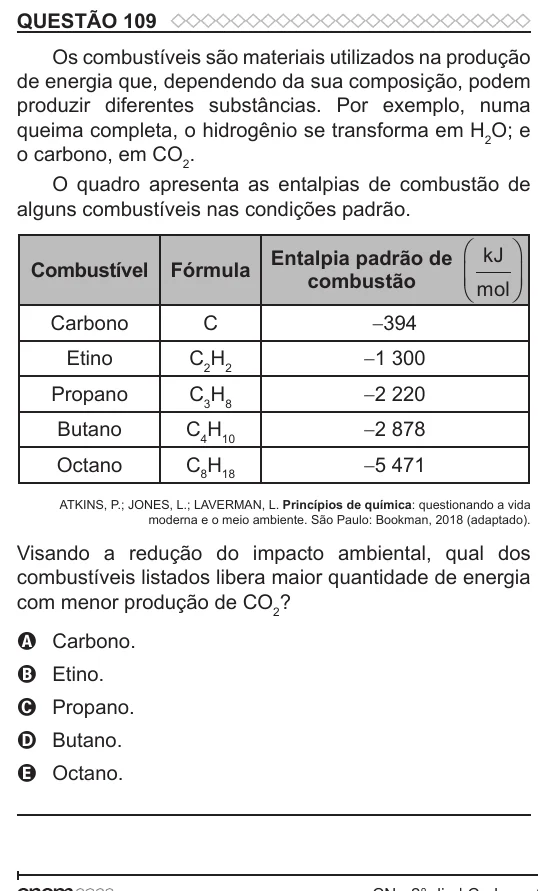

Texto extraído (pode conter ruído)

QUESTÃO 109  
Os combustíveis são materiais utilizados na produção  
de energia que, dependendo da sua composição, podem  
produzir diferentes substâncias. Por exemplo, numa  
queima completa, o hidrogênio se transforma em H 2 O; e  
o carbono, em CO 2 .  
O quadro apresenta as entalpias de combustão de  
alguns combustíveis nas condições padrão.  
Entalpia padrão de  kJ   
Combustível  
Fórmula  
 mol   
combustão  
  
  
Carbono  
C  
-394  
Etino  
C 2 H 2  
-1 300  
Propano  
C 3 H 8  
-2 220  
Butano  
C 4 H 10  
-2 878  
Octano  
C 8 H 18  
-5 471  
ATKINS, P.; JONES, L.; LAVERMAN, L. Princípios de química: questionando a vida  
moderna e o meio ambiente. São Paulo: Bookman, 2018 (adaptado).  
Visando a redução do impacto ambiental, qual dos  
combustíveis listados libera maior quantidade de energia  
com menor produção de CO 2 ?  
A Carbono.  
B Etino.  
C Propano.  
D Butano.  
E Octano.

