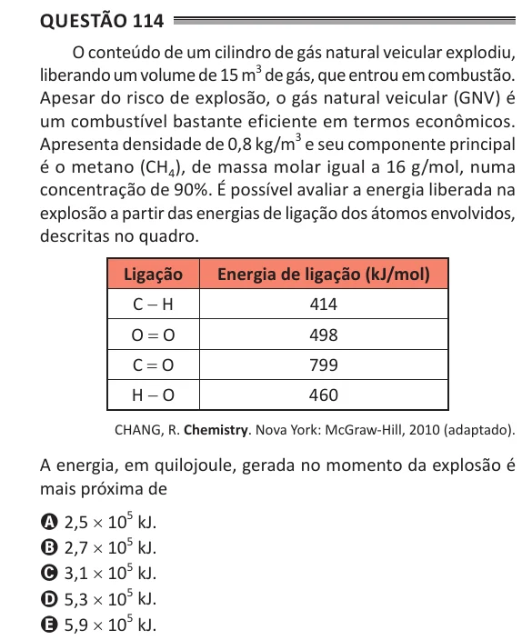

Texto extraído (pode conter ruído)

Questão 114  
O conteúdo de um cilindro de gás natural veicular explodiu,  
liberando um volume de 15 m 3 de gás, que entrou em combustão.  
Apesar do risco de explosão, o gás natural veicular (GNV) é  
um combustível bastante eficiente em termos econômicos.  
Apresenta densidade de 0,8 kg/m 3 e seu componente principal  
é o metano (CH 4 ), de massa molar igual a 16 g/mol, numa  
concentração de 90%. É possível avaliar a energia liberada na  
explosão a partir das energias de ligação dos átomos envolvidos,  
descritas no quadro.  
Ligação  
energia de ligação (kJ/mol)  
C - H  
414  
O = O  
498  
C = O  
799  
H - O  
460  
CHANG, R. Chemistry. Nova York: McGraw-Hill, 2010 (adaptado).  
A energia, em quilojoule, gerada no momento da explosão é  
mais próxima de  
A 2,5 × 10 5 kJ.  
B 2,7 × 10 5 kJ.  
C 3,1 × 10 5 kJ.  
D 5,3 × 10 5 kJ.  
E 5,9 × 10 5 kJ.

