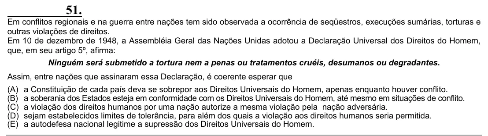

Texto extraído (pode conter ruído)

51.  
Em conflitos regionais e na guerra entre nações tem sido observada a ocorrência de seqüestros, execuções sumárias, torturas e  
outras violações de direitos.  
Em 10 de dezembro de 1948, a Assembléia Geral das Nações Unidas adotou a Declaração Universal dos Direitos do Homem,  
que, em seu artigo 5º, afirma:  
Ninguém será submetido a tortura nem a penas ou tratamentos cruéis, desumanos ou degradantes.  
Assim, entre nações que assinaram essa Declaração, é coerente esperar que  
(A) a Constituição de cada país deva se sobrepor aos Direitos Universais do Homem, apenas enquanto houver conflito.  
(B) a soberania dos Estados esteja em conformidade com os Direitos Universais do Homem, até mesmo em situações de conflito.  
(C) a violação dos direitos humanos por uma nação autorize a mesma violação pela nação adversária.  
(D) sejam estabelecidos limites de tolerância, para além dos quais a violação aos direitos humanos seria permitida.  
(E) a autodefesa nacional legitime a supressão dos Direitos Universais do Homem.

