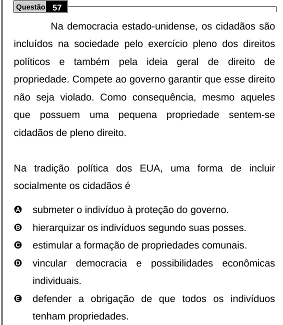

Texto extraído (pode conter ruído)

Questão 57  
Na democracia estado-unidense, os cidadãos são  
incluídos na sociedade pelo exercício pleno dos direitos  
políticos e também pela ideia geral de direito de  
propriedade. Compete ao governo garantir que esse direito  
não seja violado. Como consequência, mesmo aqueles  
que possuem uma pequena propriedade sentem-se  
cidadãos de pleno direito.  
Na tradição política dos EUA, uma forma de incluir  
socialmente os cidadãos é  
A  
submeter o indivíduo à proteção do governo.  
B  
hierarquizar os indivíduos segundo suas posses.  
C  
estimular a formação de propriedades comunais.  
D  
vincular democracia e possibilidades econômicas  
individuais.  
E  
defender a obrigação de que todos os indivíduos  
tenham propriedades.

