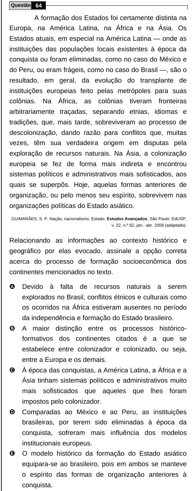

Texto extraído (pode conter ruído)

Questão 64  
A formação dos Estados foi certamente distinta na  
Europa, na América Latina, na África e na Ásia. Os  
Estados atuais, em especial na América Latina — onde as  
instituições das populações locais existentes à época da  
conquista ou foram eliminadas, como no caso do México e  
do Peru, ou eram frágeis, como no caso do Brasil —, são o  
resultado, em geral, da evolução do transplante de  
instituições europeias feito pelas metrópoles para suas  
colônias.  
Na  
África,  
as  
colônias  
tiveram  
fronteiras  
arbitrariamente traçadas, separando etnias, idiomas e  
tradições, que, mais tarde, sobreviveram ao processo de  
descolonização, dando razão para conflitos que, muitas  
vezes, têm sua verdadeira origem em disputas pela  
exploração de recursos naturais. Na Ásia, a colonização  
europeia se fez de forma mais indireta e encontrou  
sistemas políticos e administrativos mais sofisticados, aos  
quais se superpôs. Hoje, aquelas formas anteriores de  
organização, ou pelo menos seu espírito, sobrevivem nas  
organizações políticas do Estado asiático.  
GUIMARÃES, S. P. Nação, nacionalismo, Estado. Estudos Avançados. São Paulo: EdUSP,  
v. 22, n.º 62, jan.- abr. 2008 (adaptado).  
Relacionando as informações ao contexto histórico e  
geográfico por elas evocado, assinale a opção correta  
acerca do processo de formação socioeconômica dos  
continentes mencionados no texto.  
A  
Devido  
à  
falta  
de  
recursos  
naturais  
a  
serem  
explorados no Brasil, conflitos étnicos e culturais como  
os ocorridos na África estiveram ausentes no período  
da independência e formação do Estado brasileiro.  
B  
A maior distinção entre os processos histórico-  
formativos dos continentes citados é a que se  
estabelece entre colonizador e colonizado, ou seja,  
entre a Europa e os demais.  
C  
À época das conquistas, a América Latina, a África e a  
Ásia tinham sistemas políticos e administrativos muito  
mais sofisticados que aqueles que lhes foram  
impostos pelo colonizador.  
D  
Comparadas ao México e ao Peru, as instituições  
brasileiras, por terem sido eliminadas à época da  
conquista, sofreram mais influência dos modelos  
institucionais europeus.  
E  
O modelo histórico da formação do Estado asiático  
equipara-se ao brasileiro, pois em ambos se manteve  
o espírito das formas de organização anteriores à  
conquista.

