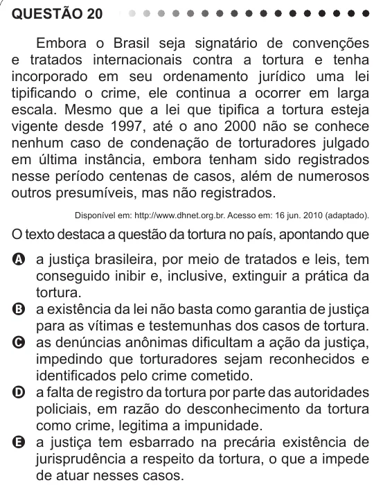

Texto extraído (pode conter ruído)

QUESTÃO 20  
Embora o Brasil seja signatário de convenções  
e tratados internacionais contra a tortura e tenha  
incorporado em seu ordenamento jurídico uma lei  
tipificando o crime, ele continua a ocorrer em larga  
escala. Mesmo que a lei que tipifica a tortura esteja  
vigente desde 1997, até o ano 2000 não se conhece  
nenhum caso de condenação de torturadores julgado  
em última instância, embora tenham sido registrados  
nesse período centenas de casos, além de numerosos  
outros presumíveis, mas não registrados.  
Disponível em: http://www.dhnet.org.br. Acesso em: 16 jun. 2010 (adaptado).  
O texto destaca a questão da tortura no país, apontando que  
A a justiça brasileira, por meio de tratados e leis, tem  
conseguido inibir e, inclusive, extinguir a prática da  
tortura.  
B a existência da lei não basta como garantia de justiça  
para as vítimas e testemunhas dos casos de tortura.  
C as denúncias anônimas dificultam a ação da justiça,  
impedindo que torturadores sejam reconhecidos e  
identificados pelo crime cometido.  
D a falta de registro da tortura por parte das autoridades  
policiais, em razão do desconhecimento da tortura  
como crime, legitima a impunidade.  
E a justiça tem esbarrado na precária existência de  
jurisprudência a respeito da tortura, o que a impede  
de atuar nesses casos.

