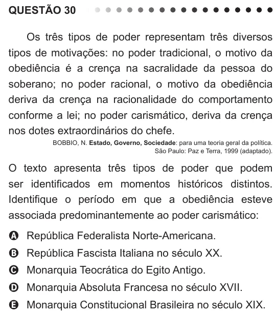

Texto extraído (pode conter ruído)

QUESTÃO 30  
Os três tipos de poder representam três diversos  
tipos de motivações: no poder tradicional, o motivo da  
obediência é a crença na sacralidade da pessoa do  
soberano; no poder racional, o motivo da obediência  
deriva da crença na racionalidade do comportamento  
conforme a lei; no poder carismático, deriva da crença  
nos dotes extraordinários do chefe.  
BOBBIO, N. Estado, Governo, Sociedade: para uma teoria geral da política.  
São Paulo: Paz e Terra, 1999 (adaptado).  
O texto apresenta três tipos de poder que podem  
ser identificados em momentos históricos distintos.  
Identifique o período em que a obediência esteve  
associada predominantemente ao poder carismático:  
A República Federalista Norte-Americana.  
B República Fascista Italiana no século XX.  
C Monarquia Teocrática do Egito Antigo.  
D Monarquia Absoluta Francesa no século XVII.  
E Monarquia Constitucional Brasileira no século XIX.

