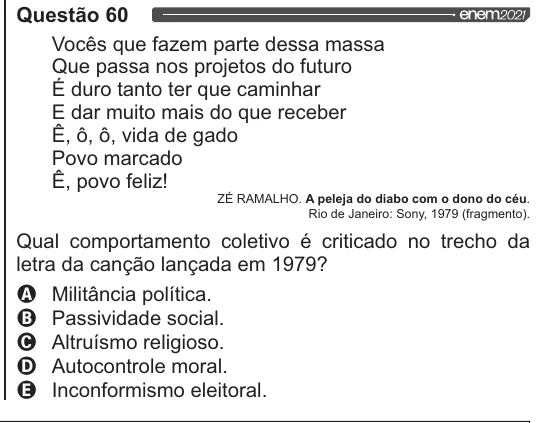

Texto extraído (pode conter ruído)

Questão 60  
Vocês que fazem parte dessa massa  
Que passa nos projetos do futuro  
É duro tanto ter que caminhar  
E dar muito mais do que receber  
Ê, 6, 6, vida de gado  
Povo marcado  
E, povo feliz!  
ZÉ RAMALHO. A peleja do diabo com o dono do céu.  
Rio de Janeiro: Sony, 1979 (fragmento).  
Qual comportamento coletivo é criticado no trecho da  
letra da canção lançada em 1979?  
OQ Militância política.  
O Passividade social.  
O Altruísmo religioso.  
O Autocontrole moral.  
& Inconformismo eleitoral.

