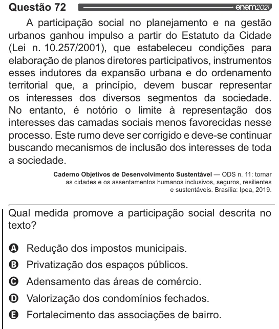

Texto extraído (pode conter ruído)

Questão 72  
A participação social no planejamento e na gestão  
urbanos ganhou impulso a partir do Estatuto da Cidade  
(Lei n. 10.257/2001), que estabeleceu condições para  
elaboração de planos diretores participativos, instrumentos  
esses indutores da expansão urbana e do ordenamento  
territorial que, a princípio, devem buscar representar  
os interesses dos diversos segmentos da sociedade.  
No entanto, é notório o limite à representação dos  
interesses das camadas sociais menos favorecidas nesse  
processo. Este rumo deve ser corrigido e deve-se continuar  
buscando mecanismos de inclusão dos interesses de toda  
a sociedade.  
Caderno Objetivos de Desenvolvimento Sustentável — ODS n. 11: tornar  
as cidades e os assentamentos humanos inclusivos, seguros, resilientes  
e sustentáveis. Brasília: Ipea, 2019.  
Qual medida promove a participação social descrita no  
texto?  
VOVOO  
Redução dos impostos municipais.  
Privatização dos espaços públicos.  
Adensamento das áreas de comércio.  
Valorização dos condomínios fechados.  
Fortalecimento das associações de bairro.

