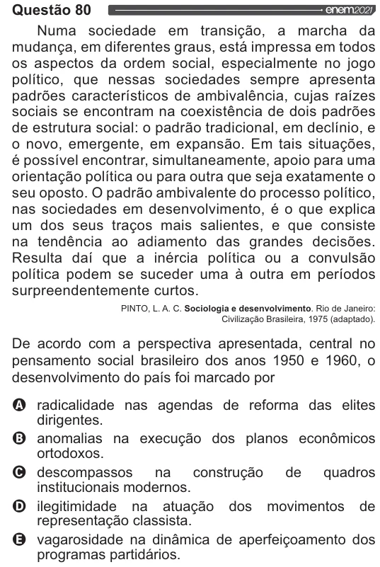

Texto extraído (pode conter ruído)

Questão 80  
Numa sociedade em transição, a marcha da  
mudança, em diferentes graus, está impressa em todos  
os aspectos da ordem social, especialmente no jogo  
político, que nessas sociedades sempre apresenta  
padrões característicos de ambivalência, cujas raízes  
sociais se encontram na coexistência de dois padrões  
de estrutura social: o padrão tradicional, em declínio, e  
o novo, emergente, em expansão. Em tais situações,  
é possível encontrar, simultaneamente, apoio para uma  
orientação política ou para outra que seja exatamente o  
seu oposto. O padrão ambivalente do processo político,  
nas sociedades em desenvolvimento, é o que explica  
um dos seus traços mais salientes, e que consiste  
na tendência ao adiamento das grandes decisões.  
Resulta daí que a inércia política ou a convulsão  
política podem se suceder uma à outra em períodos  
surpreendentemente curtos.  
PINTO, L.A. C. Sociologia e desenvolvimento. Rio de Janeiro:  
Civilização Brasileira, 1975 (adaptado).  
De acordo com a perspectiva apresentada, central no  
pensamento social brasileiro dos anos 1950 e 1960, o  
desenvolvimento do país foi marcado por  
OQ radicalidade nas agendas de reforma das elites  
dirigentes.  
O anomalias na execução dos planos econômicos  
ortodoxos.  
O descompassos na construção de quadros  
institucionais modernos.  
O ilegitimidade na atuação dos movimentos de  
representação classista.  
& vagarosidade na dinâmica de aperfeiçoamento dos  
programas partidários.

