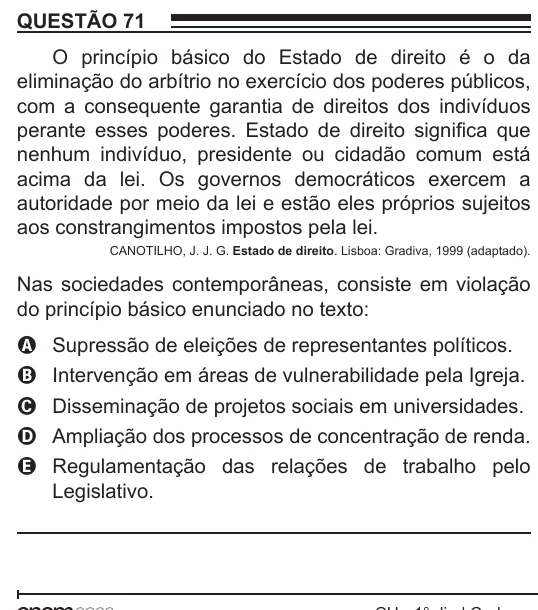

Texto extraído (pode conter ruído)

QUESTÃO 71  
O princípio básico do Estado de direito é o da  
eliminação do arbítrio no exercício dos poderes públicos,  
com a consequente garantia de direitos dos indivíduos  
perante esses poderes. Estado de direito significa que  
nenhum indivíduo, presidente ou cidadão comum está  
acima da lei. Os governos democráticos exercem a  
autoridade por meio da lei e estão eles próprios sujeitos  
aos constrangimentos impostos pela lei.  
CANOTILHO, J. J. G. Estado de direito. Lisboa: Gradiva, 1999 (adaptado).  
Nas sociedades contemporâneas, consiste em violação  
do princípio básico enunciado no texto:  
Supressão de eleições de representantes políticos.  
A  
Intervenção em áreas de vulnerabilidade pela Igreja.  
B  
Disseminação de projetos sociais em universidades.  
C  
Ampliação dos processos de concentração de renda.  
D  
E  
Regulamentação das relações de trabalho pelo  
Legislativo.

