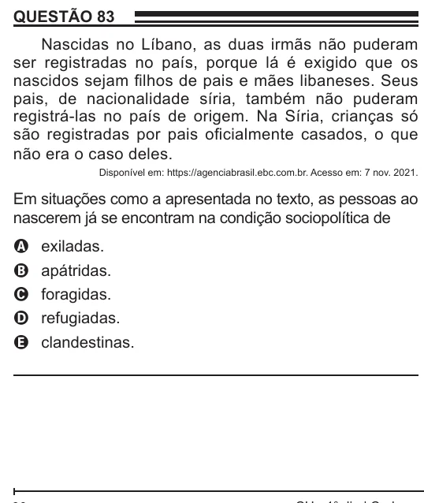

Texto extraído (pode conter ruído)

QUESTÃO 83  
Nascidas no Líbano, as duas irmãs não puderam  
ser registradas no país, porque lá é exigido que os  
nascidos sejam filhos de pais e mães libaneses. Seus  
pais, de nacionalidade síria, também não puderam  
registrá-las no país de origem. Na Síria, crianças só  
são registradas por pais oficialmente casados, o que  
não era o caso deles.  
Disponível em: https://agenciabrasil.ebc.com.br. Acesso em: 7 nov. 2021.  
Em situações como a apresentada no texto, as pessoas ao  
nascerem já se encontram na condição sociopolítica de  
exiladas.  
A  
apátridas.  
B  
foragidas.  
C  
refugiadas.  
D  
clandestinas.  
E

