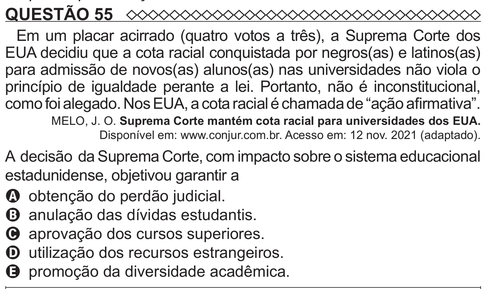

Texto extraído (pode conter ruído)

QUESTÃO 55  
Em um placar acirrado (quatro votos a três), a Suprema Corte dos  
EUA decidiu que a cota racial conquistada por negros(as) e latinos(as)  
para admissão de novos(as) alunos(as) nas universidades não viola o  
princípio de igualdade perante a lei. Portanto, não é inconstitucional,  
como foi alegado. Nos EUA, a cota racial é chamada de “ação afirmativa”.  
MELO, J. O. Suprema Corte mantém cota racial para universidades dos EUA.  
Disponível em: www.conjur.com.br. Acesso em: 12 nov. 2021 (adaptado).  
A decisão da Suprema Corte, com impacto sobre o sistema educacional  
estadunidense, objetivou garantir a  
A obtenção do perdão judicial.  
B anulação das dívidas estudantis.  
C aprovação dos cursos superiores.  
D utilização dos recursos estrangeiros.  
E promoção da diversidade acadêmica.

