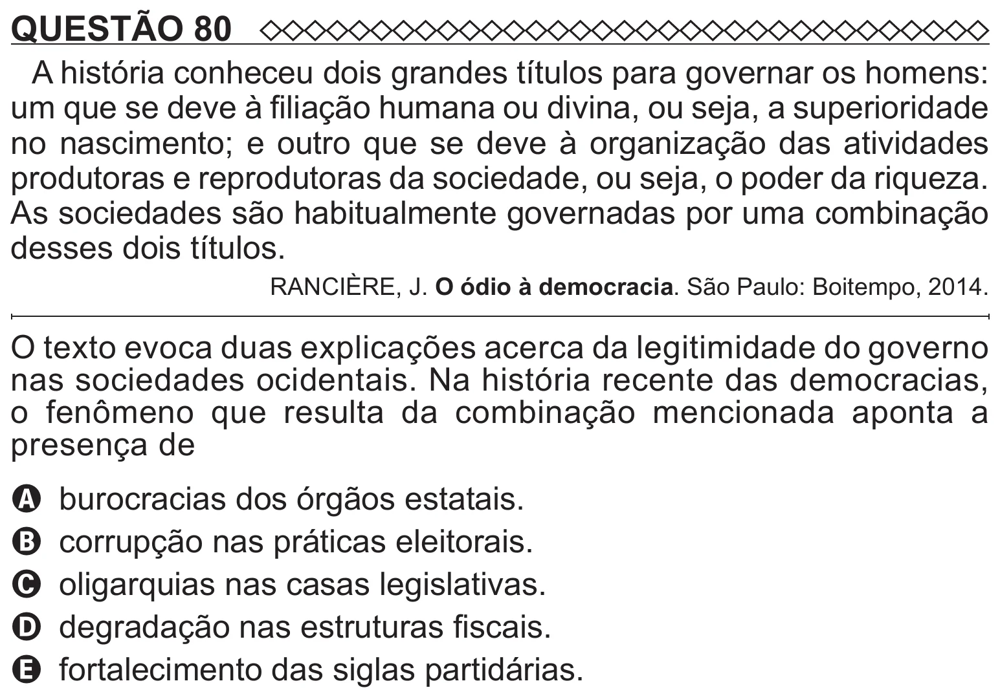

Texto extraído (pode conter ruído)

QUESTÃO 80  
A história conheceu dois grandes títulos para governar os homens:  
um que se deve à filiação humana ou divina, ou seja, a superioridade  
no nascimento; e outro que se deve à organização das atividades  
produtoras e reprodutoras da sociedade, ou seja, o poder da riqueza.  
As sociedades são habitualmente governadas por uma combinação  
desses dois títulos.  
RANCIÈRE, J. O ódio à democracia. São Paulo: Boitempo, 2014.  
O texto evoca duas explicações acerca da legitimidade do governo  
nas sociedades ocidentais. Na história recente das democracias,  
o fenômeno que resulta da combinação mencionada aponta a  
presença de  
A burocracias dos órgãos estatais.  
B corrupção nas práticas eleitorais.  
C oligarquias nas casas legislativas.  
D degradação nas estruturas fiscais.  
E fortalecimento das siglas partidárias.

