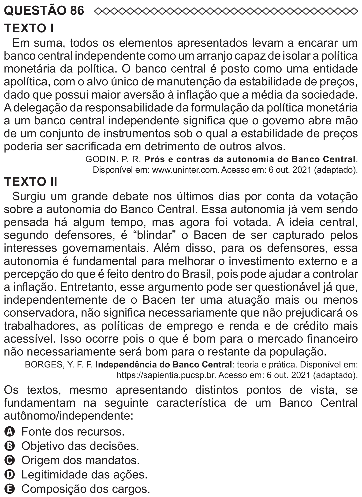

Texto extraído (pode conter ruído)

QUESTÃO 86  
TEXTO I  
Em suma, todos os elementos apresentados levam a encarar um  
banco central independente como um arranjo capaz de isolar a política  
monetária da política. O banco central é posto como uma entidade  
apolítica, com o alvo único de manutenção da estabilidade de preços,  
dado que possui maior aversão à inflação que a média da sociedade.  
A delegação da responsabilidade da formulação da política monetária  
a um banco central independente significa que o governo abre mão  
de um conjunto de instrumentos sob o qual a estabilidade de preços  
poderia ser sacrificada em detrimento de outros alvos.  
GODIN. P. R. Prós e contras da autonomia do Banco Central.  
Disponível em: www.uninter.com. Acesso em: 6 out. 2021 (adaptado).  
TEXTO II  
Surgiu um grande debate nos últimos dias por conta da votação  
sobre a autonomia do Banco Central. Essa autonomia já vem sendo  
pensada há algum tempo, mas agora foi votada. A ideia central,  
segundo defensores, é “blindar” o Bacen de ser capturado pelos  
interesses governamentais. Além disso, para os defensores, essa  
autonomia é fundamental para melhorar o investimento externo e a  
percepção do que é feito dentro do Brasil, pois pode ajudar a controlar  
a inflação. Entretanto, esse argumento pode ser questionável já que,  
independentemente de o Bacen ter uma atuação mais ou menos  
conservadora, não significa necessariamente que não prejudicará os  
trabalhadores, as políticas de emprego e renda e de crédito mais  
acessível. Isso ocorre pois o que é bom para o mercado financeiro  
não necessariamente será bom para o restante da população.  
BORGES, Y. F. F. Independência do Banco Central: teoria e prática. Disponível em:  
https://sapientia.pucsp.br. Acesso em: 6 out. 2021 (adaptado).  
Os textos, mesmo apresentando distintos pontos de vista, se  
fundamentam na seguinte característica de um Banco Central  
autônomo/independente:  
A Fonte dos recursos.  
B Objetivo das decisões.  
C Origem dos mandatos.  
D Legitimidade das ações.  
E Composição dos cargos.

