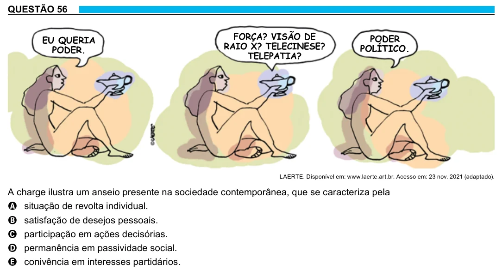

Texto extraído (pode conter ruído)

QUESTÃO 56  
FORÇA? VISÃO DE  
PODER  
EU QUERIA  
RAIO X? TELECINESE?  
PODER.  
POLÍTICO.  
TELEPATIA?  
LAERTE. Disponível em: www.laerte.art.br. Acesso em: 23 nov. 2021 (adaptado).  
A charge ilustra um anseio presente na sociedade contemporânea, que se caracteriza pela  
A situação de revolta individual.  
B satisfação de desejos pessoais.  
C participação em ações decisórias.  
D permanência em passividade social.  
E conivência em interesses partidários.

