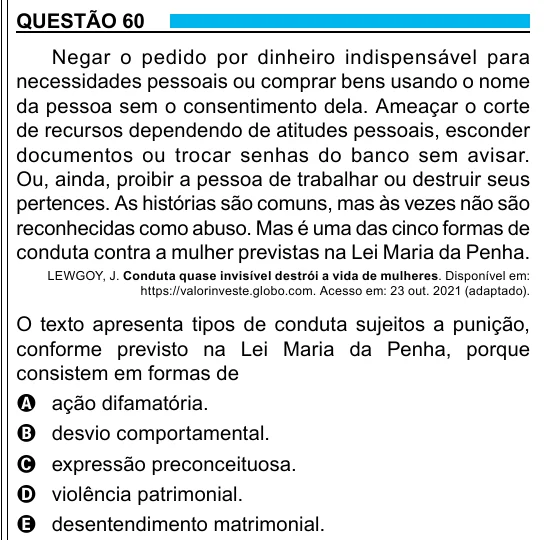

Texto extraído (pode conter ruído)

QUESTÃO 60  
Negar o pedido por dinheiro indispensável para  
necessidades pessoais ou comprar bens usando o nome  
da pessoa sem o consentimento dela. Ameaçar o corte  
de recursos dependendo de atitudes pessoais, esconder  
documentos ou trocar senhas do banco sem avisar.  
Ou, ainda, proibir a pessoa de trabalhar ou destruir seus  
pertences. As histórias são comuns, mas às vezes não são  
reconhecidas como abuso. Mas é uma das cinco formas de  
conduta contra a mulher previstas na Lei Maria da Penha.  
LEWGOY, J. Conduta quase invisível destrói a vida de mulheres. Disponível em:  
https://valorinveste.globo.com. Acesso em: 23 out. 2021 (adaptado).  
O texto apresenta tipos de conduta sujeitos a punição,  
conforme previsto na Lei Maria da Penha, porque  
consistem em formas de  
A ação difamatória.  
B desvio comportamental.  
C expressão preconceituosa.  
D violência patrimonial.  
E desentendimento matrimonial.

