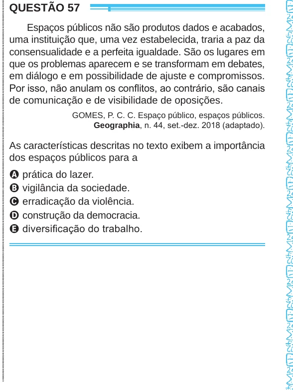

Texto extraído (pode conter ruído)

QUESTÃO 57  
Espaços públicos não são produtos dados e acabados,  
uma instituição que, uma vez estabelecida, traria a paz da  
consensualidade e a perfeita igualdade. São os lugares em  
que os problemas aparecem e se transformam em debates,  
em diálogo e em possibilidade de ajuste e compromissos.  
Por isso, não anulam os conflitos, ao contrário, são canais  
de comunicação e de visibilidade de oposições.  
GOMES, P. C. C. Espaço público, espaços públicos.  
Geographia, n. 44, set.-dez. 2018 (adaptado).  
As características descritas no texto exibem a importância  
dos espaços públicos para a  
A prática do lazer.  
B vigilância da sociedade.  
C erradicação da violência.  
D construção da democracia.  
E diversificação do trabalho.

