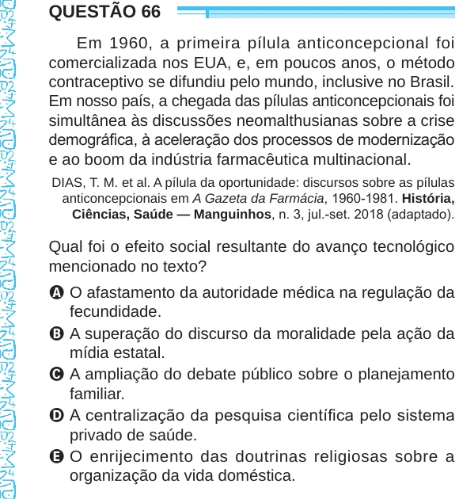

Texto extraído (pode conter ruído)

QUESTÃO 66  
Em 1960, a primeira pílula anticoncepcional foi  
comercializada nos EUA, e, em poucos anos, o método  
contraceptivo se difundiu pelo mundo, inclusive no Brasil.  
Em nosso país, a chegada das pílulas anticoncepcionais foi  
simultânea às discussões neomalthusianas sobre a crise  
demográfica, à aceleração dos processos de modernização  
e ao boom da indústria farmacêutica multinacional.  
DIAS, T. M. et al. A pílula da oportunidade: discursos sobre as pílulas  
anticoncepcionais em A Gazeta da Farmácia, 1960-1981. História,  
Ciências, Saúde — Manguinhos, n. 3, jul.-set. 2018 (adaptado).  
Qual foi o efeito social resultante do avanço tecnológico  
mencionado no texto?  
A O afastamento da autoridade médica na regulação da  
fecundidade.  
B A superação do discurso da moralidade pela ação da  
mídia estatal.  
C A ampliação do debate público sobre o planejamento  
familiar.  
D A centralização da pesquisa científica pelo sistema  
privado de saúde.  
E O enrijecimento das doutrinas religiosas sobre a  
organização da vida doméstica.

