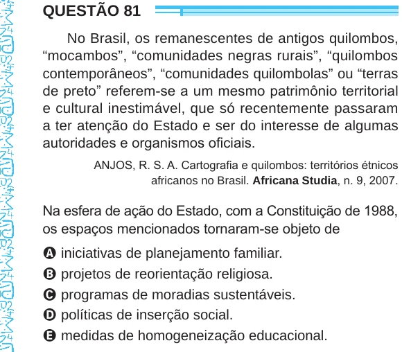

Texto extraído (pode conter ruído)

QUESTÃO 81  
No Brasil, os remanescentes de antigos quilombos,  
“mocambos”, “comunidades negras rurais”, “quilombos  
contemporâneos”, “comunidades quilombolas” ou “terras  
de preto” referem-se a um mesmo patrimônio territorial  
e cultural inestimável, que só recentemente passaram  
a ter atenção do Estado e ser do interesse de algumas  
autoridades e organismos oficiais.  
ANJOS, R. S. A. Cartografia e quilombos: territórios étnicos  
africanos no Brasil. Africana Studia, n. 9, 2007.  
Na esfera de ação do Estado, com a Constituição de 1988,  
os espaços mencionados tornaram-se objeto de  
A iniciativas de planejamento familiar.  
B projetos de reorientação religiosa.  
C programas de moradias sustentáveis.  
D políticas de inserção social.  
E medidas de homogeneização educacional.

