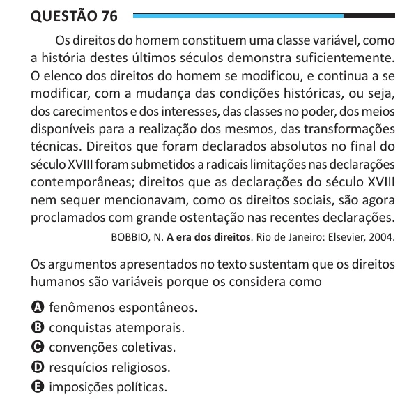

Texto extraído (pode conter ruído)

Questão 76  
Os direitos do homem constituem uma classe variável, como  
a história destes últimos séculos demonstra suficientemente.  
O elenco dos direitos do homem se modificou, e continua a se  
modificar, com a mudança das condições históricas, ou seja,  
dos carecimentos e dos interesses, das classes no poder, dos meios  
disponíveis para a realização dos mesmos, das transformações  
técnicas. Direitos que foram declarados absolutos no final do  
século XVIII foram submetidos a radicais limitações nas declarações  
contemporâneas; direitos que as declarações do século XVIII  
nem sequer mencionavam, como os direitos sociais, são agora  
proclamados com grande ostentação nas recentes declarações.  
BOBBIO, N. A era dos direitos. Rio de Janeiro: Elsevier, 2004.  
Os argumentos apresentados no texto sustentam que os direitos  
humanos são variáveis porque os considera como  
A fenômenos espontâneos.  
B conquistas atemporais.  
C convenções coletivas.  
D resquícios religiosos.  
E imposições políticas.

