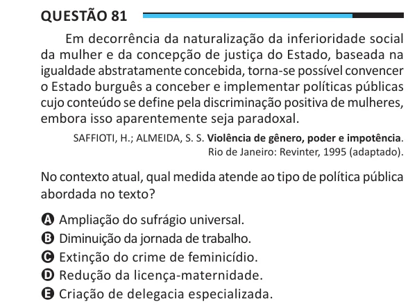

Texto extraído (pode conter ruído)

Questão 81  
Em decorrência da naturalização da inferioridade social  
da mulher e da concepção de justiça do Estado, baseada na  
igualdade abstratamente concebida, torna-se possível convencer  
o Estado burguês a conceber e implementar políticas públicas  
cujo conteúdo se define pela discriminação positiva de mulheres,  
embora isso aparentemente seja paradoxal.  
SAFFIOTI, H.; ALMEIDA, S. S. Violência de gênero, poder e impotência.  
Rio de Janeiro: Revinter, 1995 (adaptado).  
No contexto atual, qual medida atende ao tipo de política pública  
abordada no texto?  
A Ampliação do sufrágio universal.  
B Diminuição da jornada de trabalho.  
C Extinção do crime de feminicídio.  
D Redução da licença-maternidade.  
E Criação de delegacia especializada.

