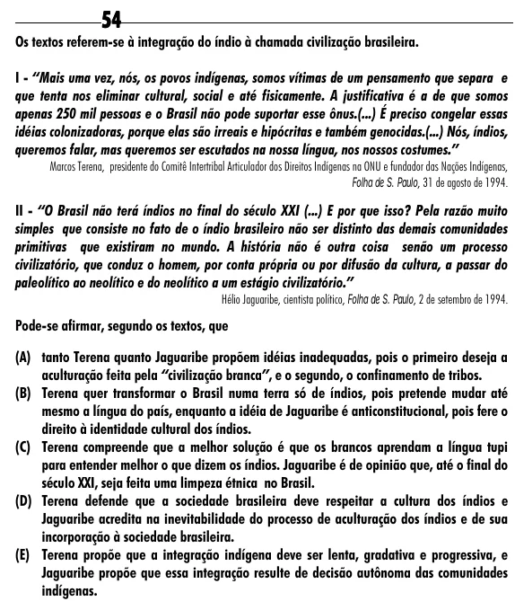

Texto extraído (pode conter ruído)

54  
Os textos referem-se à integração do índio à chamada civilização brasileira.  
I - “Mais uma vez, nós, os povos indígenas, somos vítimas de um pensamento que separa e  
que tenta nos eliminar cultural, social e até fisicamente. A justificativa é a de que somos  
apenas 250 mil pessoas e o Brasil não pode suportar esse ônus.(...) É preciso congelar essas  
idéias colonizadoras, porque elas são irreais e hipócritas e também genocidas.(...) Nós, índios,  
queremos falar, mas queremos ser escutados na nossa língua, nos nossos costumes.”  
Marcos Terena, presidente do Comitê Intertribal Articulador dos Direitos Indígenas na ONU e fundador das Nações Indígenas,  
Folha de S. Paulo, 31 de agosto de 1994.  
II - “O Brasil não terá índios no final do século XXI (...) E por que isso? Pela razão muito  
simples que consiste no fato de o índio brasileiro não ser distinto das demais comunidades  
primitivas que existiram no mundo. A história não é outra coisa senão um processo  
civilizatório, que conduz o homem, por conta própria ou por difusão da cultura, a passar do  
paleolítico ao neolítico e do neolítico a um estágio civilizatório.”  
Hélio Jaguaribe, cientista político, Folha de S. Paulo, 2 de setembro de 1994.  
Pode-se afirmar, segundo os textos, que  
(A) tanto Terena quanto Jaguaribe propõem idéias inadequadas, pois o primeiro deseja a  
aculturação feita pela “civilização branca”, e o segundo, o confinamento de tribos.  
(B) Terena quer transformar o Brasil numa terra só de índios, pois pretende mudar até  
mesmo a língua do país, enquanto a idéia de Jaguaribe é anticonstitucional, pois fere o  
direito à identidade cultural dos índios.  
(C) Terena compreende que a melhor solução é que os brancos aprendam a língua tupi  
para entender melhor o que dizem os índios. Jaguaribe é de opinião que, até o final do  
século XXI, seja feita uma limpeza étnica no Brasil.  
(D) Terena defende que a sociedade brasileira deve respeitar a cultura dos índios e  
Jaguaribe acredita na inevitabilidade do processo de aculturação dos índios e de sua  
incorporação à sociedade brasileira.  
(E) Terena propõe que a integração indígena deve ser lenta, gradativa e progressiva, e  
Jaguaribe propõe que essa integração resulte de decisão autônoma das comunidades  
indígenas.

