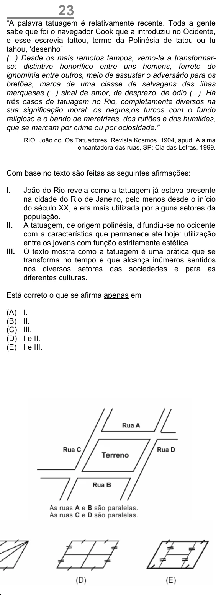

Texto extraído (pode conter ruído)

23  
“A palavra tatuagem é relativamente recente. Toda a gente  
sabe que foi o navegador Cook que a introduziu no Ocidente,  
e esse escrevia tattou, termo da Polinésia de tatou ou tu  
tahou, ‘desenho´.  
(...) Desde os mais remotos tempos, vemo-la a transformar-  
se: distintivo honorífico entre uns homens, ferrete de  
ignomínia entre outros, meio de assustar o adversário para os  
bretões, marca de uma classe de selvagens das ilhas  
marquesas (...) sinal de amor, de desprezo, de ódio (...). Há  
três casos de tatuagem no Rio, completamente diversos na  
sua significação moral: os negros,os turcos com o fundo  
religioso e o bando de meretrizes, dos rufiões e dos humildes,  
que se marcam por crime ou por ociosidade.”  
RIO, João do. Os Tatuadores. Revista Kosmos. 1904, apud: A alma  
encantadora das ruas, SP: Cia das Letras, 1999.  
Com base no texto são feitas as seguintes afirmações:  
I.  
João do Rio revela como a tatuagem já estava presente  
na cidade do Rio de Janeiro, pelo menos desde o início  
do século XX, e era mais utilizada por alguns setores da  
população.  
II.  
A tatuagem, de origem polinésia, difundiu-se no ocidente  
com a característica que permanece até hoje: utilização  
entre os jovens com função estritamente estética.  
III.  
O texto mostra como a tatuagem é uma prática que se  
transforma no tempo e que alcança inúmeros sentidos  
nos diversos setores das sociedades e para as  
diferentes culturas.  
Está correto o que se afirma apenas em  
(A)  
I.  
(B)  
II.  
(C)  
III.  
(D)  
I e II.  
(E)  
I e III.

