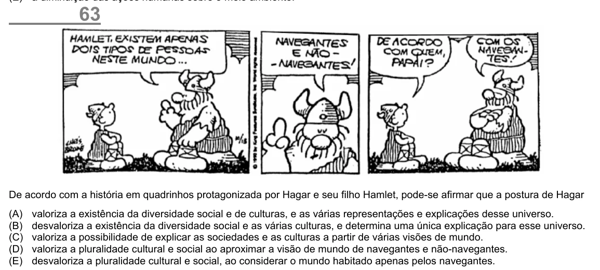

Texto extraído (pode conter ruído)

63  
De acordo com a história em quadrinhos protagonizada por Hagar e seu filho Hamlet, pode-se afirmar que a postura de Hagar  
(A)  
valoriza a existência da diversidade social e de culturas, e as várias representações e explicações desse universo.  
(B)  
desvaloriza a existência da diversidade social e as várias culturas, e determina uma única explicação para esse universo.  
(C)  
valoriza a possibilidade de explicar as sociedades e as culturas a partir de várias visões de mundo.  
(D)  
valoriza a pluralidade cultural e social ao aproximar a visão de mundo de navegantes e não-navegantes.  
(E)  
desvaloriza a pluralidade cultural e social, ao considerar o mundo habitado apenas pelos navegantes.

