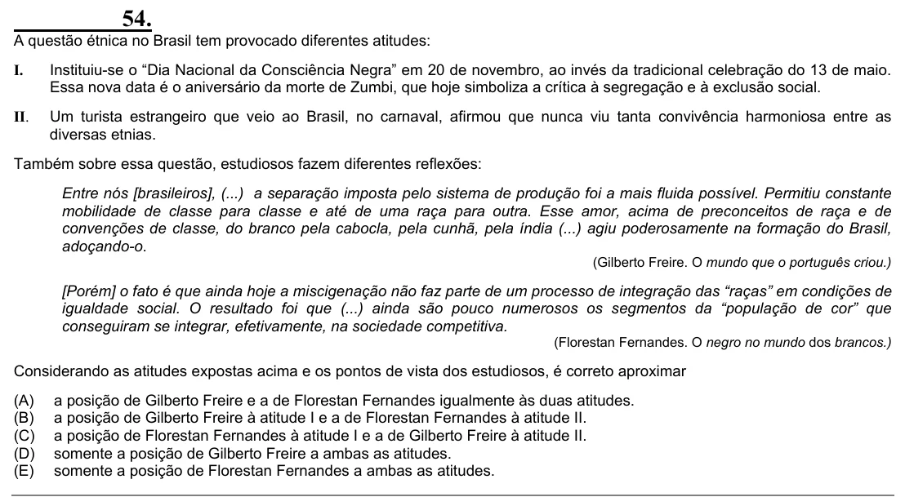

Texto extraído (pode conter ruído)

54.  
A questão étnica no Brasil tem provocado diferentes atitudes:  
I.  
Instituiu-se o “Dia Nacional da Consciência Negra” em 20 de novembro, ao invés da tradicional celebração do 13 de maio.  
Essa nova data é o aniversário da morte de Zumbi, que hoje simboliza a crítica à segregação e à exclusão social.  
II.  
Um turista estrangeiro que veio ao Brasil, no carnaval, afirmou que nunca viu tanta convivência harmoniosa entre as  
diversas etnias.  
Também sobre essa questão, estudiosos fazem diferentes reflexões:  
Entre nós [brasileiros], (...) a separação imposta pelo sistema de produção foi a mais fluida possível. Permitiu constante  
mobilidade de classe para classe e até de uma raça para outra. Esse amor, acima de preconceitos de raça e de  
convenções de classe, do branco pela cabocla, pela cunhã, pela índia (...) agiu poderosamente na formação do Brasil,  
adoçando-o.  
(Gilberto Freire. O mundo que o português criou.)  
[Porém] o fato é que ainda hoje a miscigenação não faz parte de um processo de integração das “raças” em condições de  
igualdade social. O resultado foi que (...) ainda são pouco numerosos os segmentos da “população de cor” que  
conseguiram se integrar, efetivamente, na sociedade competitiva.  
(Florestan Fernandes. O negro no mundo dos brancos.)  
Considerando as atitudes expostas acima e os pontos de vista dos estudiosos, é correto aproximar  
(A)  
a posição de Gilberto Freire e a de Florestan Fernandes igualmente às duas atitudes.  
(B)  
a posição de Gilberto Freire à atitude I e a de Florestan Fernandes à atitude II.  
(C)  
a posição de Florestan Fernandes à atitude I e a de Gilberto Freire à atitude II.  
(D)  
somente a posição de Gilberto Freire a ambas as atitudes.  
(E)  
somente a posição de Florestan Fernandes a ambas as atitudes.

