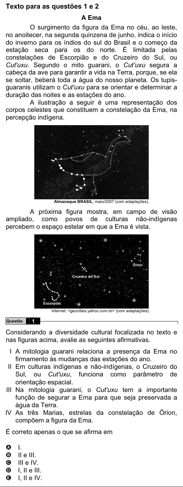

Texto extraído (pode conter ruído)

Texto para as questões 1 e 2  
A Ema  
O surgimento da figura da Ema no céu, ao leste,  
no anoitecer, na segunda quinzena de junho, indica o início  
do inverno para os índios do sul do Brasil e o começo da  
estação seca para os do norte. É limitada pelas  
constelações de Escorpião e do Cruzeiro do Sul, ou  
Cut'uxu. Segundo o mito guarani, o Cut’uxu segura a  
cabeça da ave para garantir a vida na Terra, porque, se ela  
se soltar, beberá toda a água do nosso planeta. Os tupis-  
guaranis utilizam o Cut'uxu para se orientar e determinar a  
duração das noites e as estações do ano.  
A ilustração a seguir é uma representação dos  
corpos celestes que constituem a constelação da Ema, na  
percepção indígena.  
Almanaque BRASIL, maio/2007 (com adaptações).  
A próxima figura mostra, em campo de visão  
ampliado, como povos de culturas não-indígenas  
percebem o espaço estelar em que a Ema é vista.  
Órion  
Cruzeiro do Sul  
Escorpião  
Internet: <geocities.yahoo.com.br> (com adaptações).  
Questão  
1  
Considerando a diversidade cultural focalizada no texto e  
nas figuras acima, avalie as seguintes afirmativas.  
I A mitologia guarani relaciona a presença da Ema no  
firmamento às mudanças das estações do ano.  
II Em culturas indígenas e não-indígenas, o Cruzeiro do  
Sul, ou Cut'uxu, funciona como parâmetro de  
orientação espacial.  
III Na mitologia guarani, o Cut'uxu tem a importante  
função de segurar a Ema para que seja preservada a  
água da Terra.  
IV As três Marias, estrelas da constelação de Órion,  
compõem a figura da Ema.  
É correto apenas o que se afirma em  
I.  
A  
II e III.  
B  
C  
III e IV.  
I, II e III.  
D  
I, II e IV.  
E

