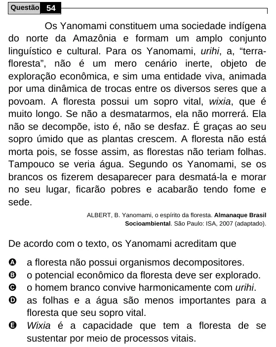

Texto extraído (pode conter ruído)

Questão 54  
Os Yanomami constituem uma sociedade indígena  
do norte da Amazônia e formam um amplo conjunto  
linguístico e cultural. Para os Yanomami, urihi, a, “terra-  
floresta”, não é um mero cenário inerte, objeto de  
exploração econômica, e sim uma entidade viva, animada  
por uma dinâmica de trocas entre os diversos seres que a  
povoam. A floresta possui um sopro vital, wixia, que é  
muito longo. Se não a desmatarmos, ela não morrerá. Ela  
não se decompõe, isto é, não se desfaz. É graças ao seu  
sopro úmido que as plantas crescem. A floresta não está  
morta pois, se fosse assim, as florestas não teriam folhas.  
Tampouco se veria água. Segundo os Yanomami, se os  
brancos os fizerem desaparecer para desmatá-la e morar  
no seu lugar, ficarão pobres e acabarão tendo fome e  
sede.  
ALBERT, B. Yanomami, o espírito da floresta. Almanaque Brasil  
Socioambiental. São Paulo: ISA, 2007 (adaptado).  
De acordo com o texto, os Yanomami acreditam que  
A  
a floresta não possui organismos decompositores.  
B  
o potencial econômico da floresta deve ser explorado.  
o homem branco convive harmonicamente com urihi.  
C  
D as folhas e a água são menos importantes para a  
floresta que seu sopro vital.  
E Wixia é a capacidade que tem a floresta de se  
sustentar por meio de processos vitais.

