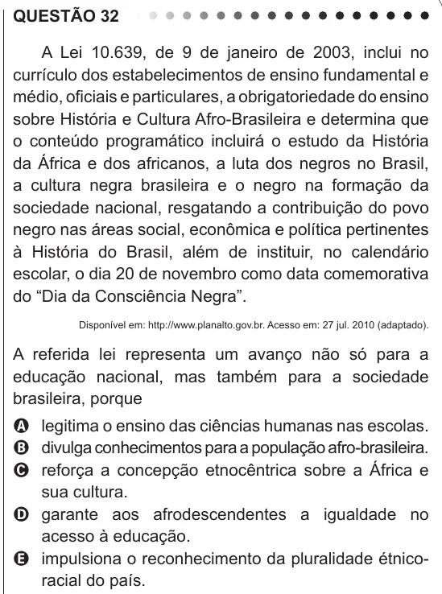

Texto extraído (pode conter ruído)

QUESTÃO 32  
A Lei 10.639, de 9 de janeiro de 2003, inclui no  
currículo dos estabelecimentos de ensino fundamental e  
médio, oficiais e particulares, a obrigatoriedade do ensino  
sobre História e Cultura Afro-Brasileira e determina que  
o conteúdo programático incluirá o estudo da História  
da África e dos africanos, a luta dos negros no Brasil,  
a cultura negra brasileira e o negro na formação da  
sociedade nacional, resgatando a contribuição do povo  
negro nas áreas social, econômica e política pertinentes  
à História do Brasil, além de instituir, no calendário  
escolar, o dia 20 de novembro como data comemorativa  
do “Dia da Consciência Negra”.  
Disponível em: http://www.planalto.gov.br. Acesso em: 27 jul. 2010 (adaptado).  
A referida lei representa um avanço não só para a  
educação nacional, mas também para a sociedade  
brasileira, porque  
A legitima o ensino das ciências humanas nas escolas.  
B divulga conhecimentos para a população afro-brasileira.  
C reforça a concepção etnocêntrica sobre a África e  
sua cultura.  
D garante aos afrodescendentes a igualdade no  
acesso à educação.  
E impulsiona o reconhecimento da pluralidade étnico-  
racial do país.

