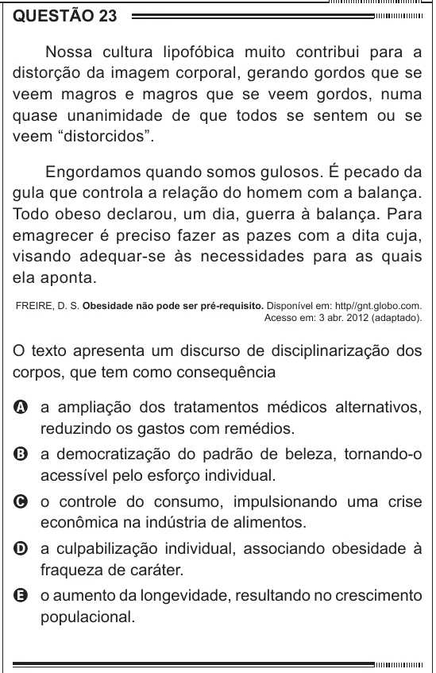

Texto extraído (pode conter ruído)

QUESTÃO 23  
Nossa cultura lipofóbica muito contribui para a  
distorção da imagem corporal, gerando gordos que se  
veem magros e magros que se veem gordos, numa  
quase unanimidade de que todos se sentem ou se  
veem “distorcidos”.  
Engordamos quando somos gulosos. É pecado da  
gula que controla a relação do homem com a balança.  
Todo obeso declarou, um dia, guerra à balança. Para  
emagrecer é preciso fazer as pazes com a dita cuja,  
visando adequar-se às necessidades para as quais  
ela aponta.  
FREIRE, D. S. Obesidade não pode ser pré-requisito. Disponível em: http//gnt.globo.com.  
Acesso em: 3 abr. 2012 (adaptado).  
O texto apresenta um discurso de disciplinarização dos  
corpos, que tem como consequência  
A a ampliação dos tratamentos médicos alternativos,  
reduzindo os gastos com remédios.  
B a democratização do padrão de beleza, tornando-o  
acessível pelo esforço individual.  
C o controle do consumo, impulsionando uma crise  
econômica na indústria de alimentos.  
D a culpabilização individual, associando obesidade à  
fraqueza de caráter.  
E o aumento da longevidade, resultando no crescimento  
populacional.

