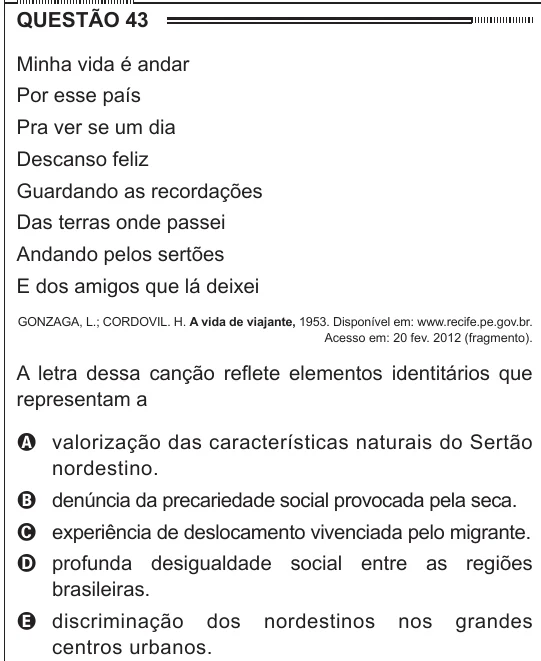

Texto extraído (pode conter ruído)

QUESTÃO 43  
Minha vida é andar  
Por esse país  
Pra ver se um dia  
Descanso feliz  
Guardando as recordações  
Das terras onde passei  
Andando pelos sertões  
E dos amigos que lá deixei  
GONZAGA, L.; CORDOVIL. H. A vida de viajante, 1953. Disponível em: www.recife.pe.gov.br.  
Acesso em: 20 fev. 2012 (fragmento).  
A letra dessa canção reflete elementos identitários que  
representam a  
A valorização das características naturais do Sertão  
nordestino.  
B denúncia da precariedade social provocada pela seca.  
C experiência de deslocamento vivenciada pelo migrante.  
D profunda desigualdade social entre as regiões  
brasileiras.  
E discriminação dos  
nordestinos  
nos  
grandes  
centros urbanos.

