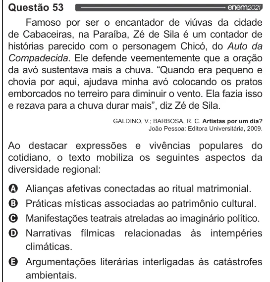

Texto extraído (pode conter ruído)

Questão 53  
Famoso por ser o encantador de viúvas da cidade  
de Cabaceiras, na Paraíba, Zé de Sila é um contador de  
histórias parecido com o personagem Chicó, do Auto da  
Compadecida. Ele defende veementemente que a oração  
da avó sustentava mais a chuva. “Quando era pequeno e  
chovia por aqui, ajudava minha avó colocando os pratos  
emborcados no terreiro para diminuir o vento. Ela fazia isso  
e rezava para a chuva durar mais”, diz Zé de Sila.  
GALDINO, V.; BARBOSA, R. C. Artistas por um dia?  
João Pessoa: Editora Universitária, 2009.  
Ao destacar expressões e vivências populares do  
cotidiano, o texto mobiliza os seguintes aspectos da  
diversidade regional:  
(A)  
Alianças afetivas conectadas ao ritual matrimonial.  
(6)  
Práticas místicas associadas ao patrimônio cultural.  
(C)  
Manifestações teatrais atreladas ao imaginário político.  
D)  
Narrativas fílmicas intempéries  
relacionadas às  
climáticas.  
LE)  
Argumentações literárias interligadas às catástrofes  
ambientais.

