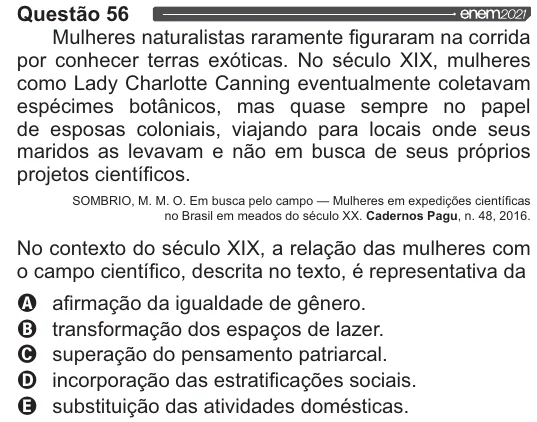

Texto extraído (pode conter ruído)

Questão 56  
Mulheres naturalistas raramente figuraram na corrida  
por conhecer terras exóticas. No século XIX, mulheres  
como Lady Charlotte Canning eventualmente coletavam  
espécimes botânicos, mas quase sempre no papel  
de esposas coloniais, viajando para locais onde seus  
maridos as levavam e não em busca de seus próprios  
projetos científicos.  
SOMBRIO, M. M. O. Em busca pelo campo — Mulheres em expedições científicas  
no Brasil em meados do século XX. Cadernos Pagu, n. 48, 2016.  
No contexto do século XIX, a relação das mulheres com  
o campo científico, descrita no texto, é representativa da  
O afirmação da igualdade de gênero.  
O transformação dos espaços de lazer.  
O superação do pensamento patriarcal.  
O incorporação das estratificações sociais.  
O substituição das atividades domésticas.

