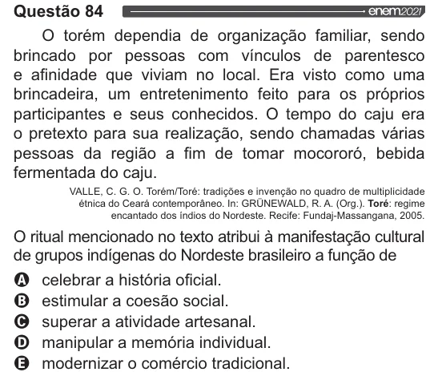

Texto extraído (pode conter ruído)

Questão 84  
enem2021  
O torém dependia de organização familiar, sendo  
brincado por pessoas com vínculos de parentesco  
e afinidade que viviam no local. Era visto como uma  
brincadeira, um entretenimento feito para os próprios  
participantes e seus conhecidos. O tempo do caju era  
o pretexto para sua realização, sendo chamadas várias  
pessoas da região a fim de tomar mocororó, bebida  
fermentada do caju.  
VALLE, C. G. O. Torém/Toré: tradições e invenção no quadro de multiplicidade  
étnica do Ceará contemporâneo. In: GRUNEWALD, R. A. (Org.). Toré: regime  
encantado dos índios do Nordeste. Recife: Fundaj-Massangana, 2005.  
O ritual mencionado no texto atribui à manifestação cultural  
de grupos indígenas do Nordeste brasileiro a função de  
VODOO  
celebrar a história oficial.  
estimular a coesão social.  
superar a atividade artesanal.  
manipular a memória individual.  
modernizar o comércio tradicional.

