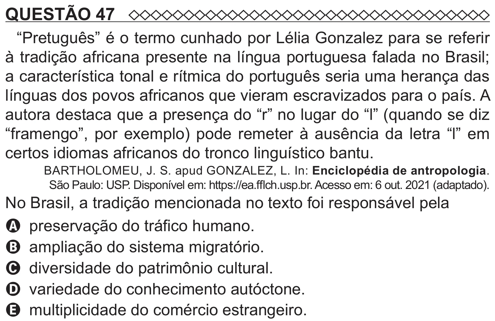

Texto extraído (pode conter ruído)

QUESTÃO 47  
“Pretuguês” é o termo cunhado por Lélia Gonzalez para se referir  
à tradição africana presente na língua portuguesa falada no Brasil;  
a característica tonal e rítmica do português seria uma herança das  
línguas dos povos africanos que vieram escravizados para o país. A  
autora destaca que a presença do “r” no lugar do “l” (quando se diz  
“framengo”, por exemplo) pode remeter à ausência da letra “l” em  
certos idiomas africanos do tronco linguístico bantu.  
BARTHOLOMEU, J. S. apud GONZALEZ, L. In: Enciclopédia de antropologia.  
São Paulo: USP. Disponível em: https://ea.fflch.usp.br. Acesso em: 6 out. 2021 (adaptado).  
No Brasil, a tradição mencionada no texto foi responsável pela  
A preservação do tráfico humano.  
B ampliação do sistema migratório.  
C diversidade do patrimônio cultural.  
D variedade do conhecimento autóctone.  
E multiplicidade do comércio estrangeiro.

