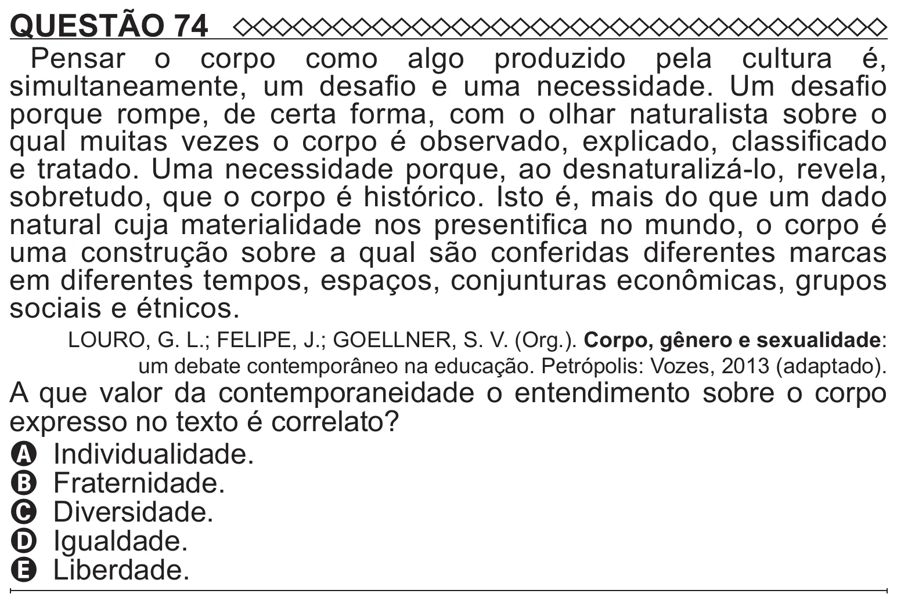

Texto extraído (pode conter ruído)

QUESTÃO 74  
Pensar o corpo como algo produzido pela cultura é,  
simultaneamente, um desafio e uma necessidade. Um desafio  
porque rompe, de certa forma, com o olhar naturalista sobre o  
qual muitas vezes o corpo é observado, explicado, classificado  
e tratado. Uma necessidade porque, ao desnaturalizá-lo, revela,  
sobretudo, que o corpo é histórico. Isto é, mais do que um dado  
natural cuja materialidade nos presentifica no mundo, o corpo é  
uma construção sobre a qual são conferidas diferentes marcas  
em diferentes tempos, espaços, conjunturas econômicas, grupos  
sociais e étnicos.  
LOURO, G. L.; FELIPE, J.; GOELLNER, S. V. (Org.). Corpo, gênero e sexualidade:  
um debate contemporâneo na educação. Petrópolis: Vozes, 2013 (adaptado).  
A que valor da contemporaneidade o entendimento sobre o corpo  
expresso no texto é correlato?  
A Individualidade.  
B Fraternidade.  
C Diversidade.  
D Igualdade.  
E Liberdade.

