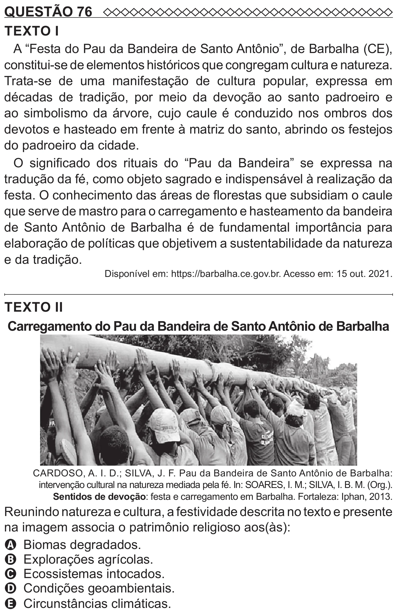

Texto extraído (pode conter ruído)

QUESTÃO 76  
TEXTO I  
A “Festa do Pau da Bandeira de Santo Antônio”, de Barbalha (CE),  
constitui-se de elementos históricos que congregam cultura e natureza.  
Trata-se de uma manifestação de cultura popular, expressa em  
décadas de tradição, por meio da devoção ao santo padroeiro e  
ao simbolismo da árvore, cujo caule é conduzido nos ombros dos  
devotos e hasteado em frente à matriz do santo, abrindo os festejos  
do padroeiro da cidade.  
O significado dos rituais do “Pau da Bandeira” se expressa na  
tradução da fé, como objeto sagrado e indispensável à realização da  
festa. O conhecimento das áreas de florestas que subsidiam o caule  
que serve de mastro para o carregamento e hasteamento da bandeira  
de Santo Antônio de Barbalha é de fundamental importância para  
elaboração de políticas que objetivem a sustentabilidade da natureza  
e da tradição.  
Disponível em: https://barbalha.ce.gov.br. Acesso em: 15 out. 2021.  
TEXTO II  
Carregamento do Pau da Bandeira de Santo Antônio de Barbalha  
CARDOSO, A. I. D.; SILVA, J. F. Pau da Bandeira de Santo Antônio de Barbalha:  
intervenção cultural na natureza mediada pela fé. In: SOARES, I. M.; SILVA, I. B. M. (Org.).  
Sentidos de devoção: festa e carregamento em Barbalha. Fortaleza: Iphan, 2013.  
Reunindo natureza e cultura, a festividade descrita no texto e presente  
na imagem associa o patrimônio religioso aos(às):  
A Biomas degradados.  
B Explorações agrícolas.  
C Ecossistemas intocados.  
D Condições geoambientais.

