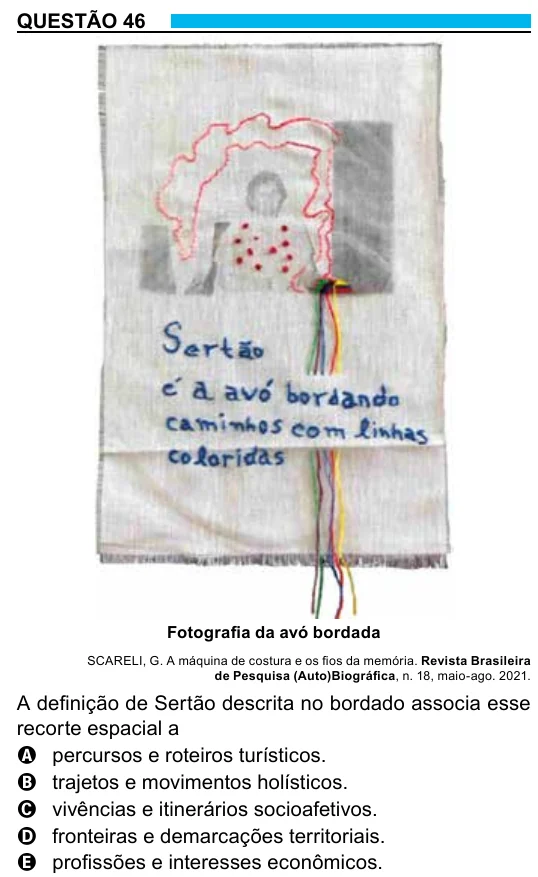

Texto extraído (pode conter ruído)

QUESTÃO 46  
Fotografia da avó bordada  
SCARELI, G. A máquina de costura e os fios da memória. Revista Brasileira  
de Pesquisa (Auto)Biográfica, n. 18, maio-ago. 2021.  
A definição de Sertão descrita no bordado associa esse  
recorte espacial a  
A percursos e roteiros turísticos.  
B trajetos e movimentos holísticos.  
C vivências e itinerários socioafetivos.  
D fronteiras e demarcações territoriais.  
E profissões e interesses econômicos.

