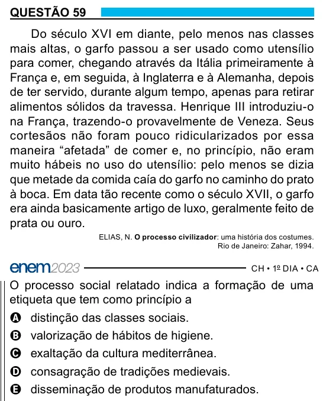

Texto extraído (pode conter ruído)

QUESTÃO 59  
Do século XVI em diante, pelo menos nas classes  
mais altas, o garfo passou a ser usado como utensílio  
para comer, chegando através da Itália primeiramente à  
França e, em seguida, à Inglaterra e à Alemanha, depois  
de ter servido, durante algum tempo, apenas para retirar  
alimentos sólidos da travessa. Henrique III introduziu-o  
na França, trazendo-o provavelmente de Veneza. Seus  
cortesãos não foram pouco ridicularizados por essa  
maneira “afetada” de comer e, no princípio, não eram  
muito hábeis no uso do utensílio: pelo menos se dizia  
que metade da comida caía do garfo no caminho do prato  
à boca. Em data tão recente como o século XVII, o garfo  
era ainda basicamente artigo de luxo, geralmente feito de  
prata ou ouro.  
ELIAS, N. O processo civilizador: uma história dos costumes.  
Rio de Janeiro: Zahar, 1994.  
O processo social relatado indica a formação de uma  
etiqueta que tem como princípio a  
A distinção das classes sociais.  
B valorização de hábitos de higiene.  
C exaltação da cultura mediterrânea.  
D consagração de tradições medievais.  
E disseminação de produtos manufaturados.

