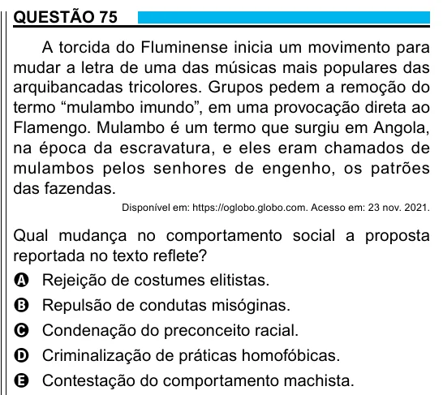

Texto extraído (pode conter ruído)

QUESTÃO 75  
A torcida do Fluminense inicia um movimento para  
mudar a letra de uma das músicas mais populares das  
arquibancadas tricolores. Grupos pedem a remoção do  
termo “mulambo imundo”, em uma provocação direta ao  
Flamengo. Mulambo é um termo que surgiu em Angola,  
na época da escravatura, e eles eram chamados de  
mulambos pelos senhores de engenho, os patrões  
das fazendas.  
Disponível em: https://oglobo.globo.com. Acesso em: 23 nov. 2021.  
Qual mudança no comportamento social a proposta  
reportada no texto reflete?  
A Rejeição de costumes elitistas.  
B Repulsão de condutas misóginas.  
C Condenação do preconceito racial.  
D Criminalização de práticas homofóbicas.  
E Contestação do comportamento machista.

