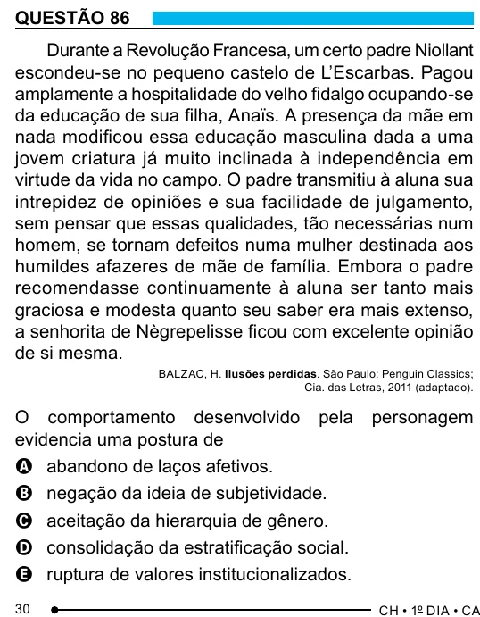

Texto extraído (pode conter ruído)

QUESTÃO 86  
Durante a Revolução Francesa, um certo padre Niollant  
escondeu-se no pequeno castelo de L’Escarbas. Pagou  
amplamente a hospitalidade do velho fidalgo ocupando-se  
da educação de sua filha, Anaïs. A presença da mãe em  
nada modificou essa educação masculina dada a uma  
jovem criatura já muito inclinada à independência em  
virtude da vida no campo. O padre transmitiu à aluna sua  
intrepidez de opiniões e sua facilidade de julgamento,  
sem pensar que essas qualidades, tão necessárias num  
homem, se tornam defeitos numa mulher destinada aos  
humildes afazeres de mãe de família. Embora o padre  
recomendasse continuamente à aluna ser tanto mais  
graciosa e modesta quanto seu saber era mais extenso,  
a senhorita de Nègrepelisse ficou com excelente opinião  
de si mesma.  
BALZAC, H. Ilusões perdidas. São Paulo: Penguin Classics;  
Cia. das Letras, 2011 (adaptado).  
O comportamento desenvolvido pela  
personagem  
evidencia uma postura de  
A abandono de laços afetivos.  
B negação da ideia de subjetividade.  
C aceitação da hierarquia de gênero.  
D consolidação da estratificação social.  
E ruptura de valores institucionalizados.  
30

