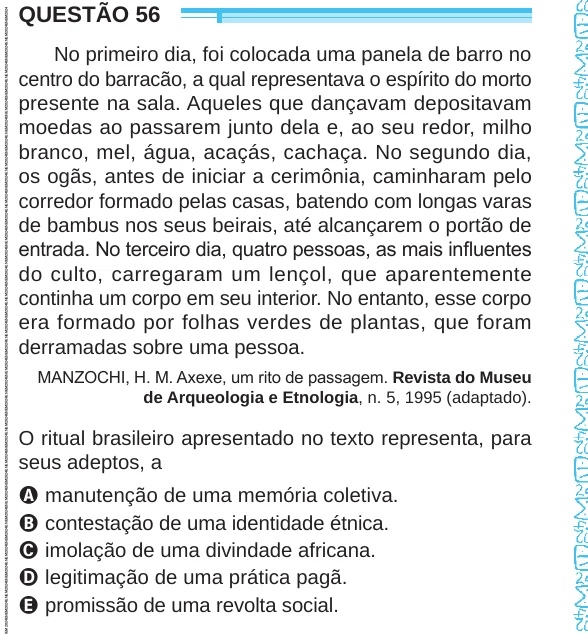

Texto extraído (pode conter ruído)

QUESTÃO 56  
No primeiro dia, foi colocada uma panela de barro no  
centro do barracão, a qual representava o espírito do morto  
presente na sala. Aqueles que dançavam depositavam  
moedas ao passarem junto dela e, ao seu redor, milho  
branco, mel, água, acaçás, cachaça. No segundo dia,  
os ogãs, antes de iniciar a cerimônia, caminharam pelo  
corredor formado pelas casas, batendo com longas varas  
de bambus nos seus beirais, até alcançarem o portão de  
entrada. No terceiro dia, quatro pessoas, as mais influentes  
do culto, carregaram um lençol, que aparentemente  
continha um corpo em seu interior. No entanto, esse corpo  
era formado por folhas verdes de plantas, que foram  
derramadas sobre uma pessoa.  
MANZOCHI, H. M. Axexe, um rito de passagem. Revista do Museu  
de Arqueologia e Etnologia, n. 5, 1995 (adaptado).  
O ritual brasileiro apresentado no texto representa, para  
seus adeptos, a  
A manutenção de uma memória coletiva.  
B contestação de uma identidade étnica.  
C imolação de uma divindade africana.  
D legitimação de uma prática pagã.  
E promissão de uma revolta social.

