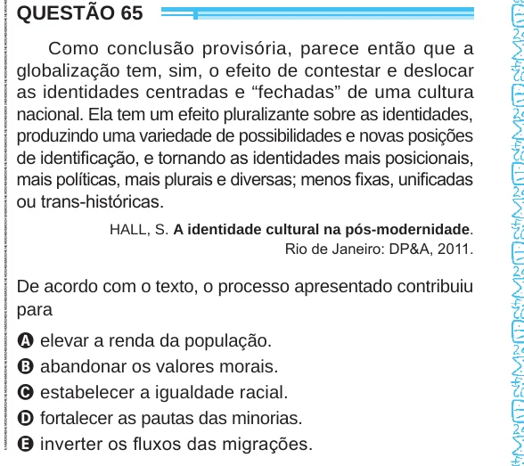

Texto extraído (pode conter ruído)

QUESTÃO 65  
Como conclusão provisória, parece então que a  
globalização tem, sim, o efeito de contestar e deslocar  
as identidades centradas e “fechadas” de uma cultura  
nacional. Ela tem um efeito pluralizante sobre as identidades,  
produzindo uma variedade de possibilidades e novas posições  
de identificação, e tornando as identidades mais posicionais,  
mais políticas, mais plurais e diversas; menos fixas, unificadas  
ou trans-históricas.  
HALL, S. A identidade cultural na pós-modernidade.  
Rio de Janeiro: DP&A, 2011.  
De acordo com o texto, o processo apresentado contribuiu  
para  
A elevar a renda da população.  
B abandonar os valores morais.  
C estabelecer a igualdade racial.  
D fortalecer as pautas das minorias.  
E inverter os fluxos das migrações.

