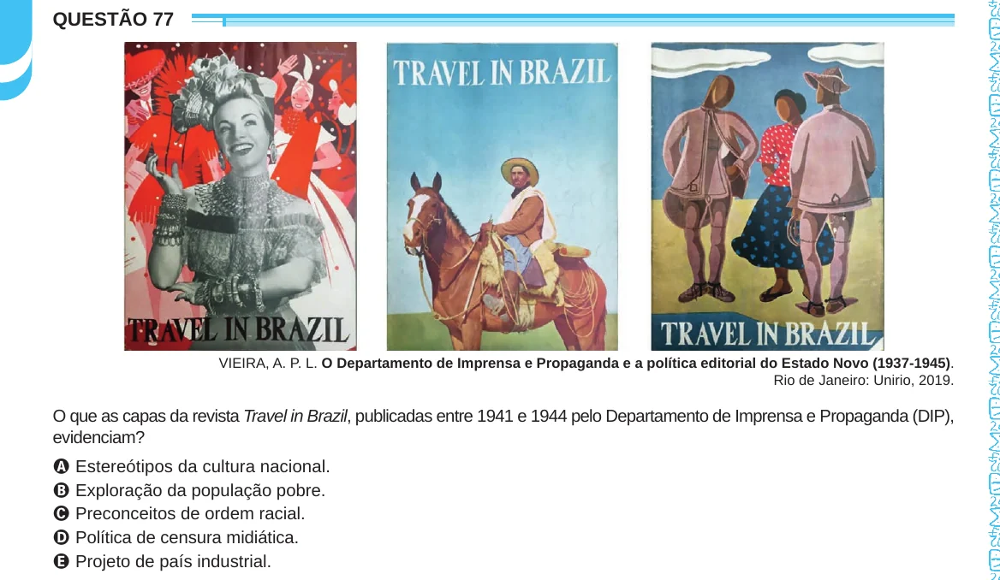

Texto extraído (pode conter ruído)

QUESTÃO 77  
VIEIRA, A. P. L. O Departamento de Imprensa e Propaganda e a política editorial do Estado Novo (1937-1945).  
Rio de Janeiro: Unirio, 2019.  
O que as capas da revista Travel in Brazil, publicadas entre 1941 e 1944 pelo Departamento de Imprensa e Propaganda (DIP),  
evidenciam?  
A Estereótipos da cultura nacional.  
B Exploração da população pobre.  
C Preconceitos de ordem racial.  
D Política de censura midiática.  
E Projeto de país industrial.

