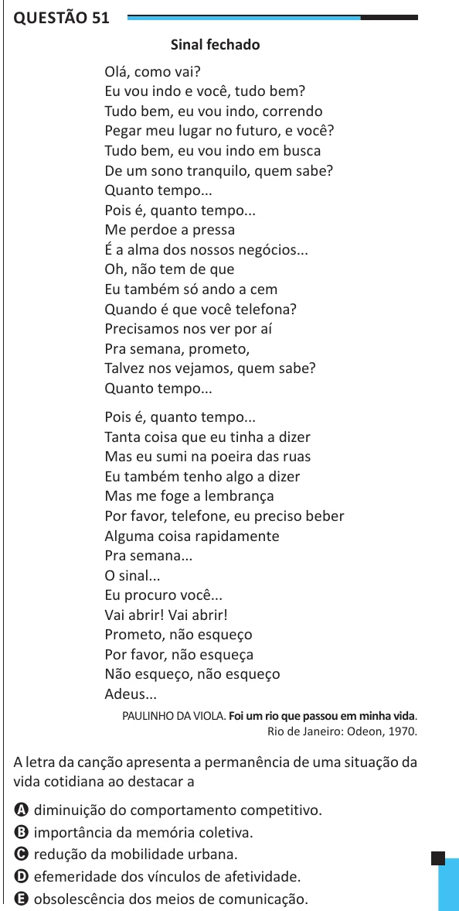

Texto extraído (pode conter ruído)

Questão 51  
Sinal fechado  
Olá, como vai?  
Eu vou indo e você, tudo bem?  
Tudo bem, eu vou indo, correndo  
Pegar meu lugar no futuro, e você?  
Tudo bem, eu vou indo em busca  
De um sono tranquilo, quem sabe?  
Quanto tempo...  
Pois é, quanto tempo...  
Me perdoe a pressa  
É a alma dos nossos negócios...  
Oh, não tem de que  
Eu também só ando a cem  
Quando é que você telefona?  
Precisamos nos ver por aí  
Pra semana, prometo,  
Talvez nos vejamos, quem sabe?  
Quanto tempo...  
Pois é, quanto tempo...  
Tanta coisa que eu tinha a dizer  
Mas eu sumi na poeira das ruas  
Eu também tenho algo a dizer  
Mas me foge a lembrança  
Por favor, telefone, eu preciso beber  
Alguma coisa rapidamente  
Pra semana...  
O sinal...  
Eu procuro você...  
Vai abrir! Vai abrir!  
Prometo, não esqueço  
Por favor, não esqueça  
Não esqueço, não esqueço  
Adeus...  
PAULINHO DA VIOLA. Foi um rio que passou em minha vida.  
Rio de Janeiro: Odeon, 1970.  
A letra da canção apresenta a permanência de uma situação da  
vida cotidiana ao destacar a  
A diminuição do comportamento competitivo.  
B importância da memória coletiva.  
C redução da mobilidade urbana.  
D efemeridade dos vínculos de afetividade.  
E obsolescência dos meios de comunicação.

