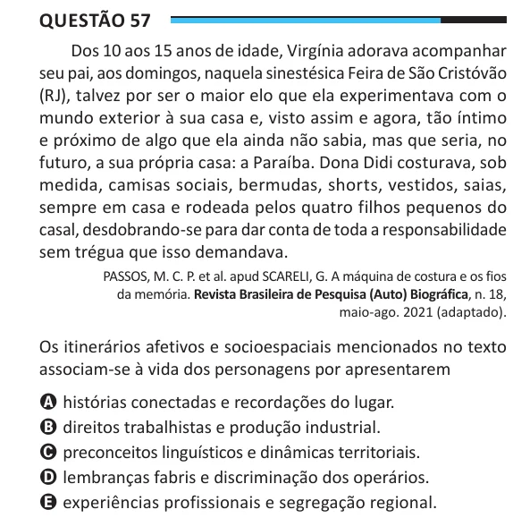

Texto extraído (pode conter ruído)

Questão 57  
Dos 10 aos 15 anos de idade, Virgínia adorava acompanhar  
seu pai, aos domingos, naquela sinestésica Feira de São Cristóvão  
(RJ), talvez por ser o maior elo que ela experimentava com o  
mundo exterior à sua casa e, visto assim e agora, tão íntimo  
e próximo de algo que ela ainda não sabia, mas que seria, no  
futuro, a sua própria casa: a Paraíba. Dona Didi costurava, sob  
medida, camisas sociais, bermudas, shorts, vestidos, saias,  
sempre em casa e rodeada pelos quatro filhos pequenos do  
casal, desdobrando-se para dar conta de toda a responsabilidade  
sem trégua que isso demandava.  
PASSOS, M. C. P. et al. apud SCARELI, G. A máquina de costura e os fios  
da memória. Revista Brasileira de Pesquisa (Auto) Biográfica, n. 18,  
maio-ago. 2021 (adaptado).  
Os itinerários afetivos e socioespaciais mencionados no texto  
associam-se à vida dos personagens por apresentarem  
A histórias conectadas e recordações do lugar.  
B direitos trabalhistas e produção industrial.  
C preconceitos linguísticos e dinâmicas territoriais.  
D lembranças fabris e discriminação dos operários.  
E experiências profissionais e segregação regional.

