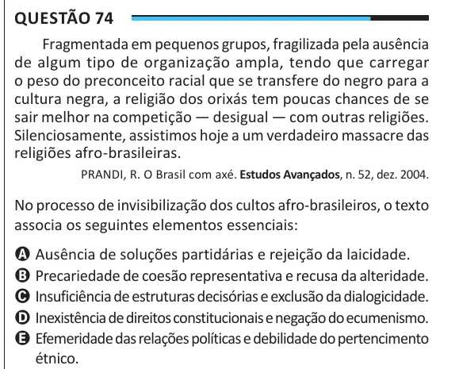

Texto extraído (pode conter ruído)

Questão 74  
Fragmentada em pequenos grupos, fragilizada pela ausência  
de algum tipo de organização ampla, tendo que carregar  
o peso do preconceito racial que se transfere do negro para a  
cultura negra, a religião dos orixás tem poucas chances de se  
sair melhor na competição — desigual — com outras religiões.  
Silenciosamente, assistimos hoje a um verdadeiro massacre das  
religiões afro-brasileiras.  
PRANDI, R. O Brasil com axé. Estudos Avançados, n. 52, dez. 2004.  
No processo de invisibilização dos cultos afro-brasileiros, o texto  
associa os seguintes elementos essenciais:  
A Ausência de soluções partidárias e rejeição da laicidade.  
B Precariedade de coesão representativa e recusa da alteridade.  
C Insuficiência de estruturas decisórias e exclusão da dialogicidade.  
D Inexistência de direitos constitucionais e negação do ecumenismo.  
E Efemeridade das relações políticas e debilidade do pertencimento  
étnico.

