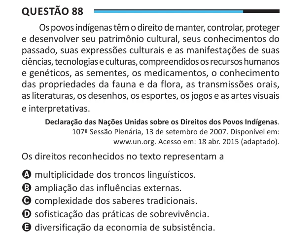

Texto extraído (pode conter ruído)

Questão 88  
Os povos indígenas têm o direito de manter, controlar, proteger  
e desenvolver seu patrimônio cultural, seus conhecimentos do  
passado, suas expressões culturais e as manifestações de suas  
ciências, tecnologias e culturas, compreendidos os recursos humanos  
e genéticos, as sementes, os medicamentos, o conhecimento  
das propriedades da fauna e da flora, as transmissões orais,  
as literaturas, os desenhos, os esportes, os jogos e as artes visuais  
e interpretativas.  
Declaração das Nações Unidas sobre os Direitos dos Povos Indígenas.  
107ª Sessão Plenária, 13 de setembro de 2007. Disponível em:  
www.un.org. Acesso em: 18 abr. 2015 (adaptado).  
Os direitos reconhecidos no texto representam a  
A multiplicidade dos troncos linguísticos.  
B ampliação das influências externas.  
C complexidade dos saberes tradicionais.  
D sofisticação das práticas de sobrevivência.  
E diversificação da economia de subsistência.

