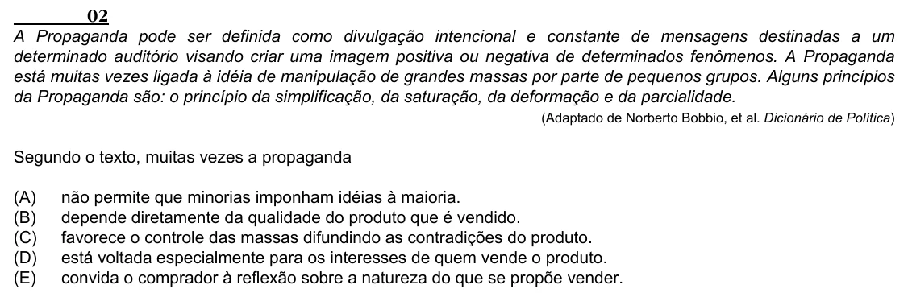

Texto extraído (pode conter ruído)

02  
A Propaganda pode ser definida como divulgação intencional e constante de mensagens destinadas a um  
determinado auditório visando criar uma imagem positiva ou negativa de determinados fenômenos. A Propaganda  
está muitas vezes ligada à idéia de manipulação de grandes massas por parte de pequenos grupos. Alguns princípios  
da Propaganda são: o princípio da simplificação, da saturação, da deformação e da parcialidade.  
(Adaptado de Norberto Bobbio, et al. Dicionário de Política)  
Segundo o texto, muitas vezes a propaganda  
(A)  
não permite que minorias imponham idéias à maioria.  
(B)  
depende diretamente da qualidade do produto que é vendido.  
(C)  
favorece o controle das massas difundindo as contradições do produto.  
(D)  
está voltada especialmente para os interesses de quem vende o produto.  
(E)  
convida o comprador à reflexão sobre a natureza do que se propõe vender.

