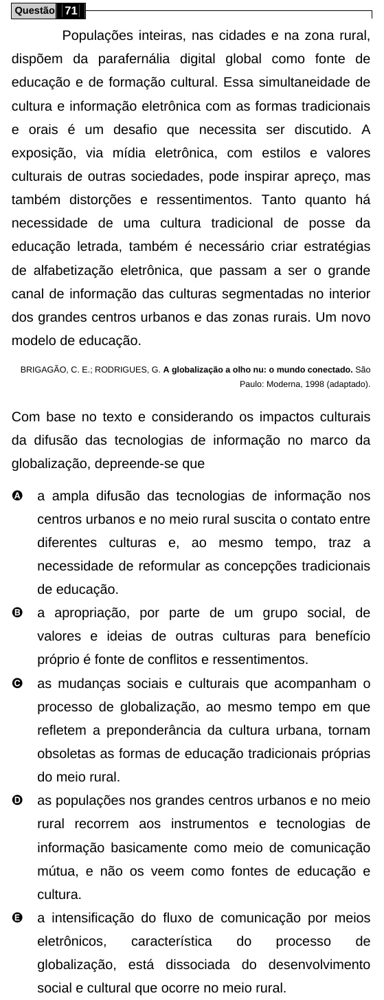

Texto extraído (pode conter ruído)

Questão 71  
Populações inteiras, nas cidades e na zona rural,  
dispõem da parafernália digital global como fonte de  
educação e de formação cultural. Essa simultaneidade de  
cultura e informação eletrônica com as formas tradicionais  
e orais é um desafio que necessita ser discutido. A  
exposição, via mídia eletrônica, com estilos e valores  
culturais de outras sociedades, pode inspirar apreço, mas  
também distorções e ressentimentos. Tanto quanto há  
necessidade de uma cultura tradicional de posse da  
educação letrada, também é necessário criar estratégias  
de alfabetização eletrônica, que passam a ser o grande  
canal de informação das culturas segmentadas no interior  
dos grandes centros urbanos e das zonas rurais. Um novo  
modelo de educação.  
BRIGAGÃO, C. E.; RODRIGUES, G. A globalização a olho nu: o mundo conectado. São  
Paulo: Moderna, 1998 (adaptado).  
Com base no texto e considerando os impactos culturais  
da difusão das tecnologias de informação no marco da  
globalização, depreende-se que  
A  
a ampla difusão das tecnologias de informação nos  
centros urbanos e no meio rural suscita o contato entre  
diferentes culturas e, ao mesmo tempo, traz a  
necessidade de reformular as concepções tradicionais  
de educação.  
B  
a apropriação, por parte de um grupo social, de  
valores e ideias de outras culturas para benefício  
próprio é fonte de conflitos e ressentimentos.  
C  
as mudanças sociais e culturais que acompanham o  
processo de globalização, ao mesmo tempo em que  
refletem a preponderância da cultura urbana, tornam  
obsoletas as formas de educação tradicionais próprias  
do meio rural.  
D  
as populações nos grandes centros urbanos e no meio  
rural recorrem aos instrumentos e tecnologias de  
informação basicamente como meio de comunicação  
mútua, e não os veem como fontes de educação e  
cultura.  
E  
a intensificação do fluxo de comunicação por meios  
eletrônicos,  
característica  
do  
processo  
de  
globalização, está dissociada do desenvolvimento  
social e cultural que ocorre no meio rural.

